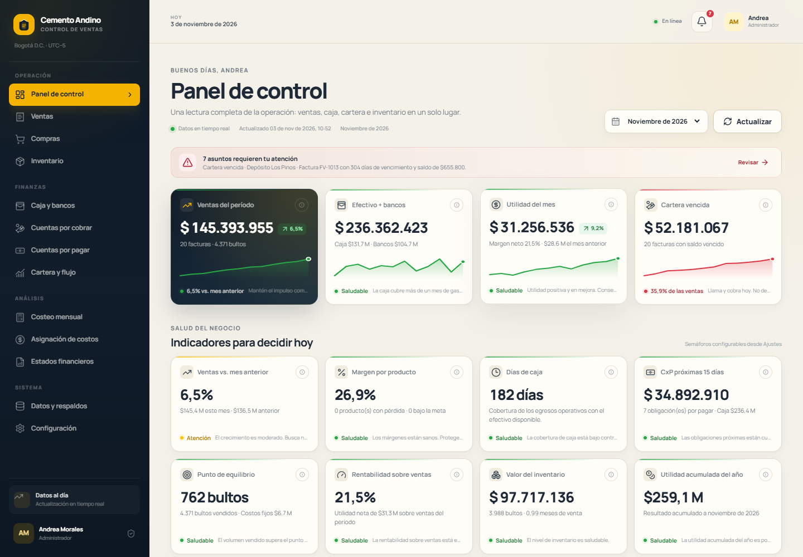

# CementoControl

Aplicación web completa para el control de ventas, compras, inventario, cartera y finanzas de una distribuidora de cemento. Está diseñada para computador y celular, en español, con moneda en pesos colombianos (COP) y fechas en la zona horaria de Colombia (UTC−5).



## Lo que incluye

- **Panel de control** con los indicadores de crecimiento, caja, margen, punto de equilibrio, cartera, inventario, utilidad y EOQ, con semáforos, fórmulas y recomendaciones.
- **Ventas** con cliente nuevo o existente, contado o crédito, cotero, cargue, factura automática editable, 4x1000 automático y cartera.
- **Compras** con proveedor y producto creados en el mismo formulario, flete y descargue por concepto, abonos y cuentas por pagar automáticas.
- **Caja y bancos** con saldo en tiempo real, categorías y movimientos manuales.
- **Cuentas por cobrar y por pagar**, abonos, vencimientos y alertas.
- **Cartera consolidada** con antigüedad de saldos y proyección de flujo a 8 semanas.
- **Inventario** con costo promedio ponderado, kardex, ajustes con motivo y EOQ por producto.
- **Costeo mensual y asignación de costos indirectos** por volumen o valor de venta.
- **Estados financieros**: resultados, balance y flujo de caja, exportables a PDF y Excel.
- **Importación y exportación** de información en JSON, Excel y CSV, con validación previa.
- **Respaldos manuales y automáticos**, restauración con copia de seguridad previa.
- **Usuarios con roles**: administrador, vendedor y contador.
- **Diseño responsive** con navegación lateral en escritorio y menú inferior en móvil.

## Stack técnico

| Capa | Tecnología |
|---|---|
| Frontend | React 18 + Vite + Chart.js + Lucide |
| Backend | Node.js 24 + Express |
| Base de datos | SQLite embebida (`node:sqlite`), relacional y transaccional |
| Autenticación | Sesiones con cookie HttpOnly + contraseñas con scrypt |
| Documentos | PDF del sistema, PDF/PNG de registros, Excel con ExcelJS, CSV |
| Despliegue | Docker / Docker Compose o ejecución directa con Node.js |

> **Decisión de arquitectura:** se usa SQLite en lugar de un servidor PostgreSQL/MySQL para que la aplicación sea autocontenida, se instale sin servicios externos y sea fácil de respaldar. El esquema es relacional y todas las operaciones contables se ejecutan con transacciones. Si la operación requiere varias sedes o alta concurrencia, se puede migrar el esquema a PostgreSQL conservando los servicios de dominio.

## Requisitos

- **Node.js 24 o superior** (obligatorio: el backend usa `node:sqlite`, incluido desde Node 22 y estabilizado en Node 24).
- Navegador moderno: Chrome, Edge, Firefox o Safari recientes.
- Opcional: Docker 24+ y Docker Compose para despliegue.
- No requiere PostgreSQL, MySQL ni servidor web adicional.

## Inicio rápido en Windows

```powershell
cd cemento-control
.\scripts\start.ps1
```

O manualmente:

```powershell
npm install
npm run build
npm start
```

Abre **http://127.0.0.1:8787**.

En Linux/macOS, `npm install && npm run build && npm start` o `./scripts/start.sh`.

La primera vez, el sistema crea la base de datos y carga automáticamente **12 meses de datos de demostración**. Si ya existen usuarios, no vuelve a cargar datos.

### Usuarios de demostración

| Rol | Usuario | Contraseña |
|---|---|---|
| Administrador | `admin` | `admin123` |
| Vendedor | `vendedor` | `venta123` |
| Contador | `contador` | `contador123` |

> Cambia las contraseñas desde el menú de usuario antes de usar la aplicación con información real. En producción usa el botón **Cambiar contraseña** de cada usuario.

## Scripts

| Comando | Descripción |
|---|---|
| `npm run dev` | API con recarga automática + Vite en desarrollo (web: http://127.0.0.1:5178) |
| `npm run build` | Compila la SPA en `web/dist` |
| `npm start` | Sirve la SPA compilada y la API (http://127.0.0.1:8787) |
| `npm run seed` | **Reinicia** la base y recarga los datos de demostración |
| `npm test` | Ejecuta la suite de pruebas de API |

`npm run seed` elimina todos los datos actuales. Úsalo solo en demostración o desarrollo.

## Configuración

Copia `.env.example` como `.env`:

```env
PORT=8787
HOST=127.0.0.1
DB_FILE=./data/cemento.db
COOKIE_SECURE=false
```

| Variable | Uso |
|---|---|
| `PORT` | Puerto HTTP (por defecto 8787) |
| `HOST` | Interfaz de escucha. Usa `0.0.0.0` para acceso desde celular en la misma red |
| `DB_FILE` | Ruta de la base SQLite. Por defecto `data/cemento.db` |
| `COOKIE_SECURE` | `true` sólo si la app está publicada detrás de HTTPS |

La configuración comercial, impuestos, umbrales de semáforos, usuarios y respaldos también se administran desde **Configuración** dentro de la aplicación.

### Acceso desde un celular en la misma red

1. Edita `.env` y cambia `HOST=0.0.0.0`.
2. Inicia la app con `npm start`.
3. Obtén la IP local del PC con `ipconfig` (por ejemplo `192.168.1.40`).
4. Abre en el celular `http://192.168.1.40:8787`.
5. Permite el puerto 8787 en el firewall de Windows si es necesario.

No expongas el puerto directamente a Internet sin HTTPS y una red confiable: la aplicación está pensada para operación interna.

## Despliegue con Docker

```bash
docker compose up -d --build
```

La aplicación queda en **http://localhost:8787**. La carpeta local `./data` se monta en el contenedor y conserva base de datos y respaldos. El healthcheck consulta `/api/health`.

Para cambiar el puerto publicado edita `docker-compose.yml` (`8787:8787`).

### Actualizar

```bash
docker compose up -d --build
```

Antes de una actualización importante, crea un respaldo desde **Datos y respaldos**.

## Datos y respaldos

- Base de datos: `data/cemento.db` (archivos WAL asociados mientras la app corre).
- Respaldos automáticos: `data/backups`, una vez al día después de la hora configurada (por defecto 23:00).
- Respaldo manual: **Datos y respaldos → Respaldos → Crear respaldo ahora**.
- Exportación: JSON completo, Excel completo, Excel/CSV por módulo.
- Restauración: **Datos y respaldos → Restaurar un respaldo** (crea una copia pre-restauración y cierra las sesiones).
- Para migrar de servidor, copia `data/cemento.db` y la carpeta `data/backups`, o usa un respaldo JSON.

## Estructura del proyecto

```
cemento-control/
├── server/                  API Express, base de datos y reglas de negocio
│   ├── services/            Operaciones transaccionales, analítica, reportes, importación
│   ├── routes/              Endpoints REST
│   ├── lib/                 Fechas, dinero y utilidades HTTP
│   ├── db.js                Esquema SQLite y transacciones
│   ├── seed.js              Datos de demostración
│   └── index.js             Arranque del servidor
├── web/                     SPA React + Vite
│   ├── src/components/      Componentes reutilizables
│   ├── src/pages/           Módulos y pantallas
│   └── src/styles.css       Sistema visual responsive
├── docs/                    Arquitectura, API, manual y capturas
├── tests/                   Pruebas de API, UI y verificación visual
├── data/                    Base de datos y respaldos (volumen persistente)
├── scripts/                 Arranque asistido en Windows/Linux
├── Dockerfile
├── docker-compose.yml
└── package.json
```

## Documentación

- [Arquitectura y reglas de negocio](docs/ARQUITECTURA.md)
- [Referencia de API](docs/API.md)
- [Manual de usuario ilustrado](docs/MANUAL_USUARIO.md)
- [Manual en PDF](docs/manual-usuario.pdf)
- [Guía de pruebas y QA](tests/README.md)

## Pruebas

La suite `npm test` levanta una base de datos temporal, carga datos de demostración y verifica autenticación, dashboard, ventas, cartera, compras, caja, inventario, ajustes, configuración, exportaciones, PDF y respaldo. No modifica tu base principal.

También hay utilidades de QA en `tests/` para auditoría visual con Playwright. `playwright-core` está incluido como dependencia de desarrollo y usa Chrome o Edge instalado en el sistema. Consulta `tests/README.md` para ejecutarlas en una base aislada.

## Límites conocidos y notas de operación

- Moneda: pesos colombianos sin centavos en la interfaz. Las cifras internas conservan dos decimales.
- La aplicación es monoempresa. Los usuarios comparten la misma base y no existe aislamiento multiempresa.
- Las ventas a crédito con abonos registrados no pueden editarse ni eliminarse para preservar el historial de cobros.
- Las compras con productos ya vendidos pueden bloquear una edición o eliminación si dejarían inventario negativo.
- El balance general es un reporte gerencial; incluye una línea de conciliación de resultados acumulados para cuadrar activos, pasivos y patrimonio.
- El IVA está configurable pero su cálculo detallado no se aplica automáticamente a las facturas. El 4x1000 sí se calcula sobre cobros por bancos.
- La integración con DIAN/facturación electrónica no está incluida.
- El modo offline es opcional en la especificación y no está implementado; la app requiere conexión al servidor local o remoto.

## Seguridad

- Cookies `HttpOnly`, `SameSite=Lax`, expiración de sesión 12 h y limpieza al cerrar sesión.
- Contraseñas con `scrypt` y sal aleatoria.
- Validación de permisos en servidor para cada módulo y operación.
- Rate limit básico de intentos de login.
- Respaldos sin cifrado: protégelos con permisos de disco y no los publiques.
- Para Internet, publica detrás de HTTPS (reverse proxy) y activa `COOKIE_SECURE=true`.

---

CementoControl v1.0 · Hecho para operaciones de cemento con datos claros y decisiones a tiempo.
