# Manual de usuario — CementoControl

**Versión 1.0 · Noviembre de 2026**  
Sistema de control de ventas, compras, inventario y finanzas para distribuidores de cemento.

---

## Contenido

1. [Primer ingreso](#1-primer-ingreso)
2. [El panel de control](#2-el-panel-de-control)
3. [Ventas](#3-ventas)
4. [Compras](#4-compras)
5. [Inventario y ajustes](#5-inventario-y-ajustes)
6. [Caja y bancos](#6-caja-y-bancos)
7. [Cuentas por cobrar](#7-cuentas-por-cobrar)
8. [Cuentas por pagar](#8-cuentas-por-pagar)
9. [Cartera y flujo de caja](#9-cartera-y-flujo-de-caja)
10. [Costeo mensual](#10-costeo-mensual)
11. [Estados financieros](#11-estados-financieros)
12. [Datos y respaldos](#12-datos-y-respaldos)
13. [Configuración](#13-configuración)
14. [Uso desde el celular](#14-uso-desde-el-celular)
15. [Buenas prácticas y preguntas frecuentes](#15-buenas-prácticas-y-preguntas-frecuentes)

---

## 1. Primer ingreso

Abre la dirección que te entregó el administrador (por ejemplo `http://127.0.0.1:8787`). Verás la pantalla de acceso con el nombre de tu empresa.

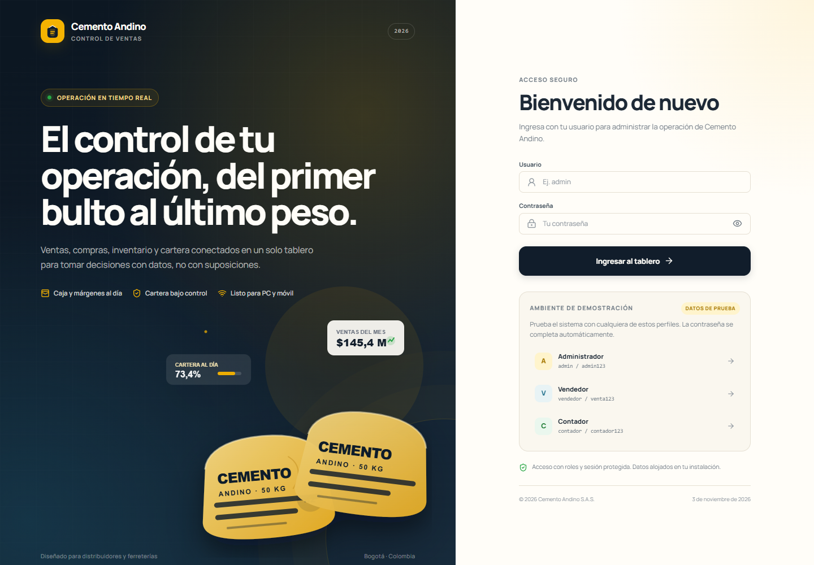
*Pantalla de inicio de sesión con acceso a los perfiles de demostración.*

1. Escribe tu **usuario** y **contraseña**.
2. Pulsa **Ingresar al tablero**.
3. En la instalación de demostración puedes usar uno de los perfiles precargados:

| Rol | Usuario | Contraseña |
|---|---|---|
| Administrador | `admin` | `admin123` |
| Vendedor | `vendedor` | `venta123` |
| Contador | `contador` | `contador123` |

> **Importante:** las cuentas de demostración son públicas. Cambia las contraseñas antes de registrar información real. Cada usuario puede hacerlo desde el menú de su perfil, arriba a la derecha, en **Seguridad de la cuenta**.

La sesión permanece activa durante 12 horas. Si no tienes permiso para un módulo, la opción no aparece en el menú.

---

## 2. El panel de control

El **Panel de control** resume el estado de la operación del mes seleccionado. Puedes cambiar el período con el selector de la esquina superior derecha o pulsar **Actualizar** para recalcular con los datos más recientes.

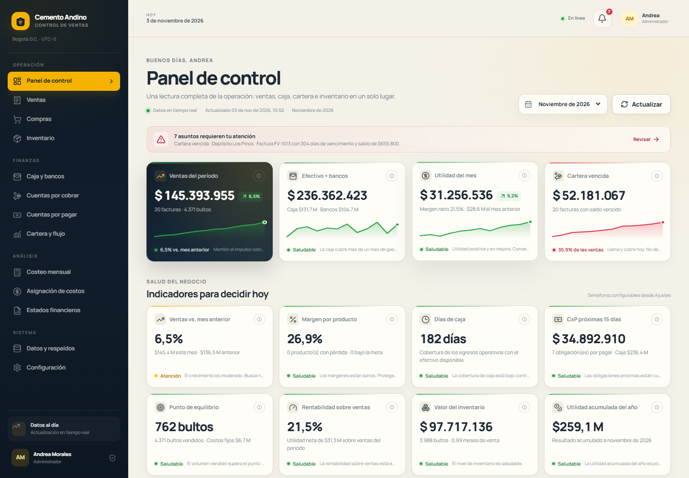
*Vista principal del panel: ventas, caja, utilidad y cartera vencida.*

Cada tarjeta tiene un punto de color, un valor y una recomendación. El botón de información (ⓘ) de cada indicador explica la fórmula utilizada y qué hacer cuando la alerta está en rojo.

- **Verde:** indicador saludable.
- **Amarillo:** requiere seguimiento.
- **Rojo:** requiere una acción pronta.

Los cuatro indicadores principales son ventas del período, efectivo + bancos, utilidad del mes y cartera vencida. Debajo, la sección **Indicadores para decidir hoy** amplía la lectura de liquidez, márgenes, punto de equilibrio, inventario y EOQ.

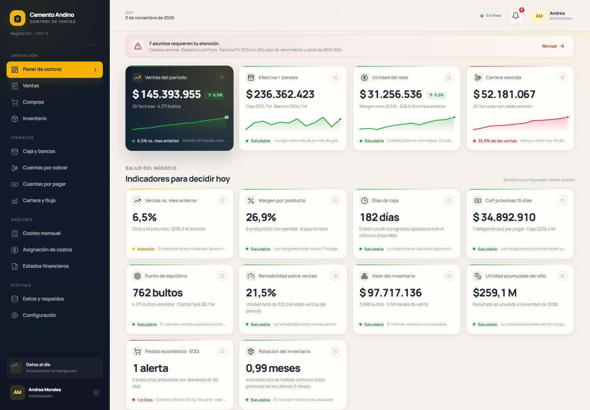
*Indicadores agrupados con semáforos y acciones recomendadas.*

La franja de alerta superior muestra el asunto más urgente. Pulsa **Revisar** para ir directamente al módulo correspondiente. La campana del encabezado concentra todas las alertas.

El panel también incluye:

- **Gráfica de ventas y utilidad de los últimos 12 meses.**
- **Participación de costos:** material, flete, descargue, indirectos y 4x1000.
- **Ventas por producto y por cliente:** identifica concentración y márgenes.
- **Política de compra EOQ:** stock vs. cantidad económica de pedido, frecuencia de pedidos, costo frente al óptimo y días de faltantes.

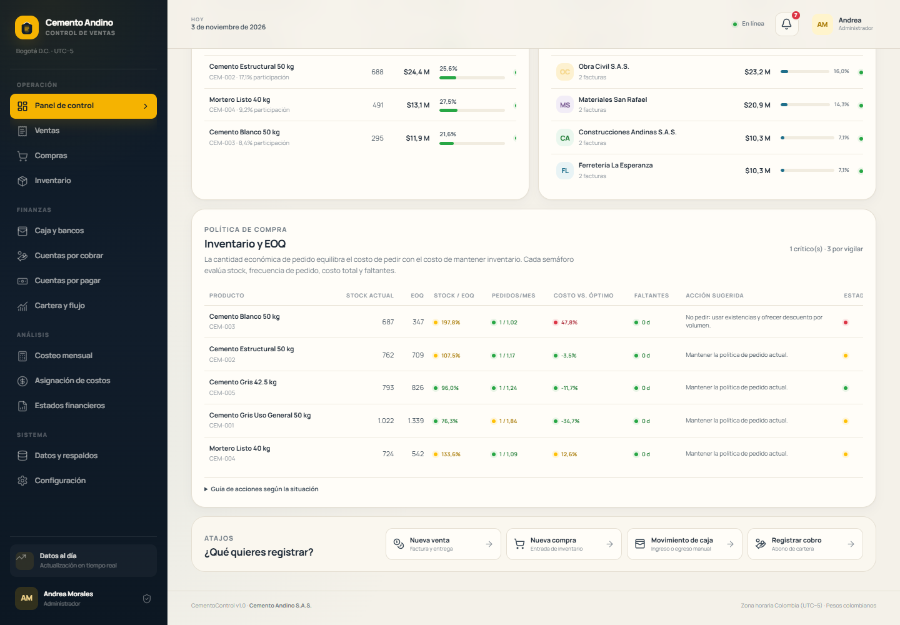
*Cada fila evalúa stock/EOQ, pedidos, costo y faltantes.*

> **Lectura del EOQ:** el sistema estima la demanda con las ventas de los últimos 90 días. Si el stock está por debajo del 50 % del EOQ, sugiere pedir ya; si está muy por encima, sugiere usar existencias antes de volver a comprar.

---

## 3. Ventas

En **Ventas** se registran las facturas de despacho. El listado permite filtrar por mes, estado o texto, y muestra total, saldo, vencimiento y estado de cartera.

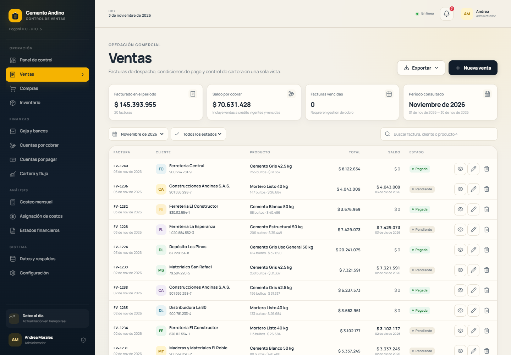
*Listado de ventas con filtros, estados y acciones.*

Las acciones de cada fila son:

- **Ver factura:** abre el documento, desde donde puedes descargar **PDF** o **PNG**.
- **Editar:** disponible para ventas sin abonos registrados.
- **Eliminar:** revierte inventario y movimientos de caja; si la venta tiene abonos, el sistema lo impide para conservar el historial.

### Crear una venta

Pulsa **Nueva venta**. El formulario se divide en tres secciones.

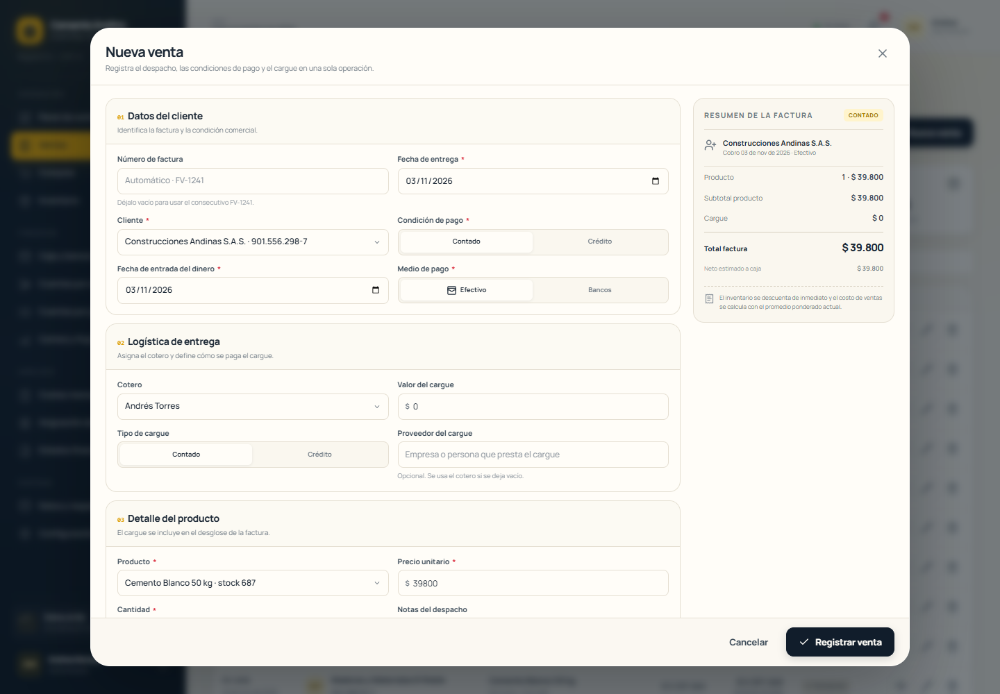
*Formulario de venta con resumen lateral de la factura.*

**01 · Datos del cliente**

- El número de factura es automático y se puede editar. Si dejas el campo vacío, se asigna el siguiente consecutivo.
- Selecciona **Fecha de entrega**.
- Elige un cliente existente o pulsa **+ Registrar cliente nuevo** para crearlo sin salir del formulario.
- Define **Contado** o **Crédito**. Para crédito es obligatorio indicar el vencimiento.
- Indica la **fecha de entrada del dinero** y el medio. Si eliges **Bancos**, el sistema calcula el 4x1000 sobre el total y lo registra como egreso.

**02 · Logística de entrega**

- Selecciona un cotero o crea uno nuevo.
- Escribe el **valor del cargue**, que se suma al desglose de la factura.
- Escoge si el cargue es **Contado** o **Crédito**. Si es crédito, se crea automáticamente una cuenta por pagar al proveedor del servicio.
- Puedes indicar el proveedor del cargue; si lo dejas vacío se usa el cotero.

**03 · Detalle del producto**

- Selecciona el producto. El sistema muestra el stock disponible y propone el precio de venta.
- Ajusta cantidad y precio.
- El resumen lateral muestra subtotal, cargue, total, 4x1000 estimado, saldo a cartera y margen estimado.
- Revisa los campos marcados con asterisco y pulsa **Registrar venta**.

Al guardar, el inventario se descuenta de inmediato y el costo de ventas se calcula con el costo promedio vigente.

### Documento de venta

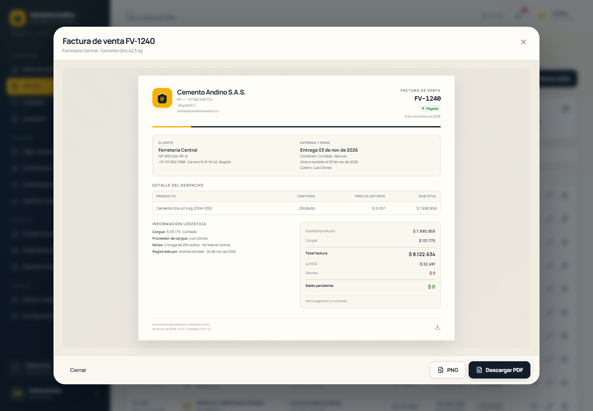
*Vista de la factura. Los botones PNG y Descargar PDF se encuentran en el pie.*

El documento incluye datos del cliente, entrega, condiciones, producto, cargue, notas, abonos registrados y saldos. Los archivos se generan con el nombre de la factura.

---

## 4. Compras

El módulo **Compras** registra la entrada de producto y capitaliza el flete y el descargue en el costo unitario. El listado muestra costo total, saldo y estado del crédito.

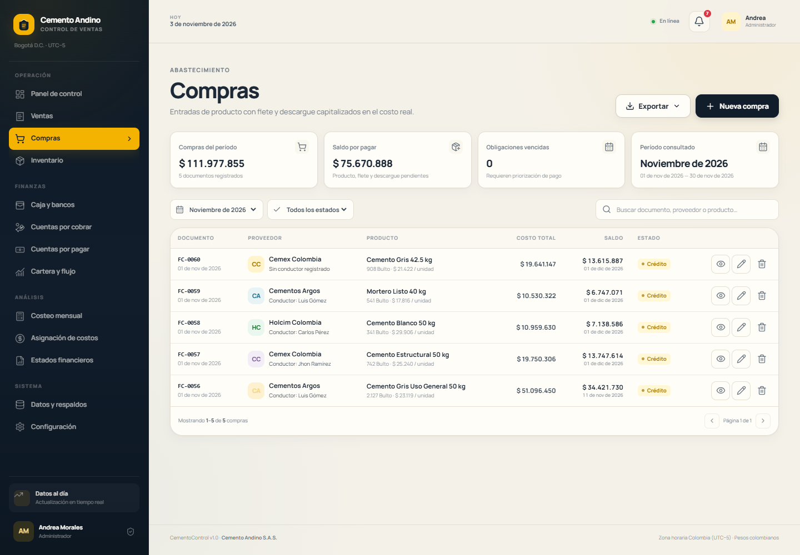
*Compras del período con proveedor, producto y saldo.*

### Crear una compra

Pulsa **Nueva compra**.

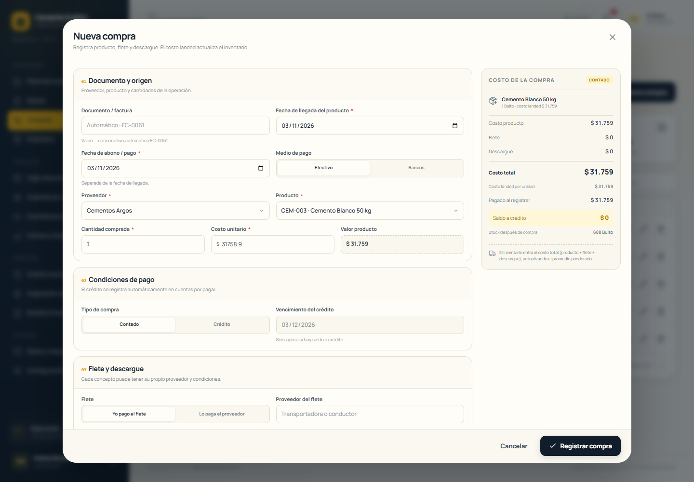
*Formulario de compra con costo landed y desglose de pagos.*

**01 · Documento y origen**

- Documento automático editable.
- Fecha de llegada del producto y fecha de abono/pago separadas.
- Proveedor y producto existentes, o creación de ambos en el mismo formulario.
- Cantidad y costo unitario.
- Medio de pago.

**02 · Condiciones de pago**

- **Contado:** se registra el pago completo al guardar.
- **Crédito:** permite un abono inicial y una fecha de vencimiento. El saldo se registra en cuentas por pagar.

**03 · Flete y descargue**

- Indica si el flete lo paga el negocio o el proveedor.
- Si lo paga el negocio, registra conductor, valor, contado/crédito y anticipo.
- Registra el descargue, su proveedor y si es contado o crédito.
- Cada concepto a crédito genera su propia obligación, con proveedor y vencimiento.

El resumen de la derecha muestra costo del producto, flete, descargue, costo total, costo landed por unidad, pagado al registrar y saldo a crédito.

> **Costo landed:** el costo que entra al inventario es la suma de producto + flete + descargue. Así el margen refleja el costo real de tener el cemento en bodega.

---

## 5. Inventario y ajustes

**Inventario** muestra existencias, costo promedio, precio, margen, valor total y semáforo EOQ. Las compras, ventas y ajustes actualizan el stock automáticamente.

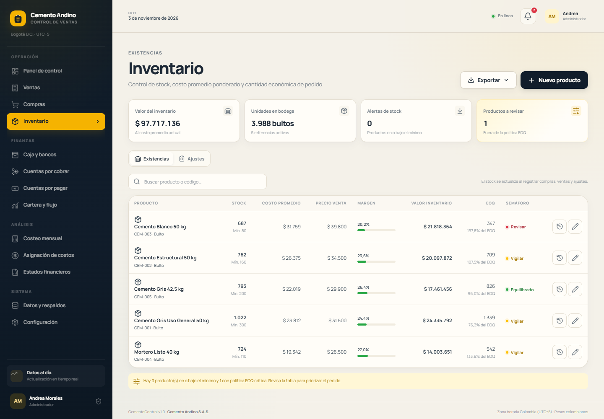
*Existencias con costo promedio ponderado y estado de la política EOQ.*

### Kardex

Pulsa el icono de historial de un producto para abrir su **Kardex**: fecha, tipo, referencia, cantidad, costo y saldo acumulado.

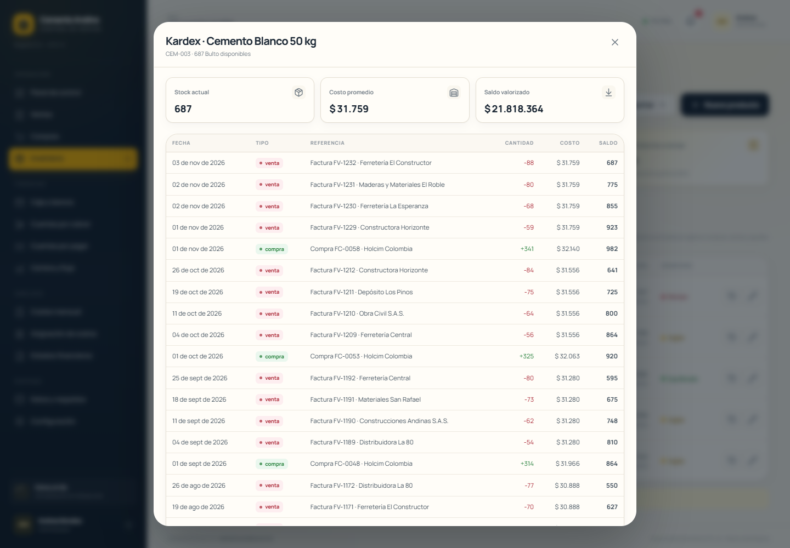
*Historial de movimientos y saldo valorizado.*

### Ajustes

En la pestaña **Ajustes** registra entradas o salidas que no corresponden a compras o ventas: mermas, daños, correcciones o reposiciones.

1. Pulsa **Registrar ajuste**.
2. Selecciona producto, tipo y cantidad.
3. Escribe el **motivo**, que es obligatorio.
4. Confirma.

El sistema recalcula el stock y el costo promedio. Para las salidas no se permite retirar más de lo disponible.

---

## 6. Caja y bancos

**Caja y bancos** muestra el saldo disponible, el flujo del período y todos los movimientos. La parte superior separa efectivo y bancos.

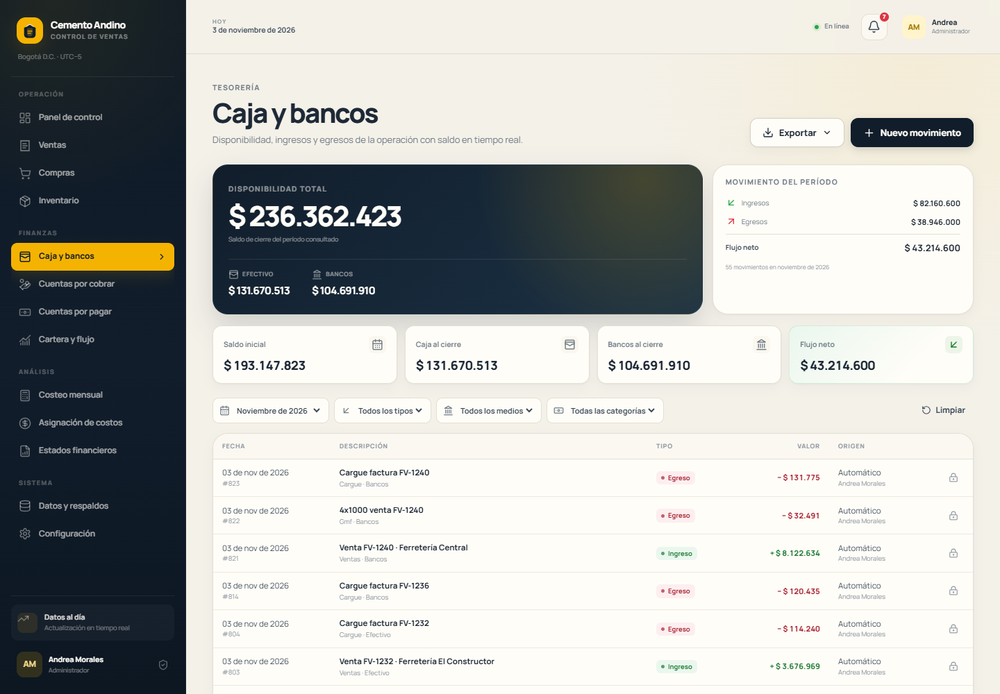
*Disponibilidad, flujo del período y movimientos detallados.*

- Filtra por período, tipo (ingreso/egreso), medio y categoría.
- Los movimientos automáticos (ventas, compras, abonos y pagos) llevan candado. Se editan desde su operación de origen para conservar la trazabilidad.
- Usa **Nuevo movimiento** para ingresos o egresos manuales como nómina, servicios o aportes.
- Exporta la caja a Excel o CSV desde **Exportar**.

> Los movimientos manuales no modifican cartera ni inventario. Si necesitas afectar una factura, usa cobros o pagos en cartera.

---

## 7. Cuentas por cobrar

**Cuentas por cobrar** concentra las facturas pendientes a crédito. Muestra cartera total, vencida, próximos vencimientos y recaudo del mes.

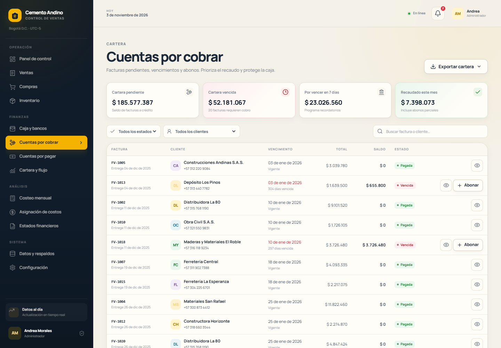
*Resumen y facturas pendientes con filtros por cliente y estado.*

- Filtra por estado (`Pendiente`, `Por vencer`, `Vencida`, `Pagada`), cliente o número de factura.
- Pulsa **Abonar** en una factura para registrar un cobro total o parcial.
- Pulsa el ojo para ver la cuenta y su historial de abonos.

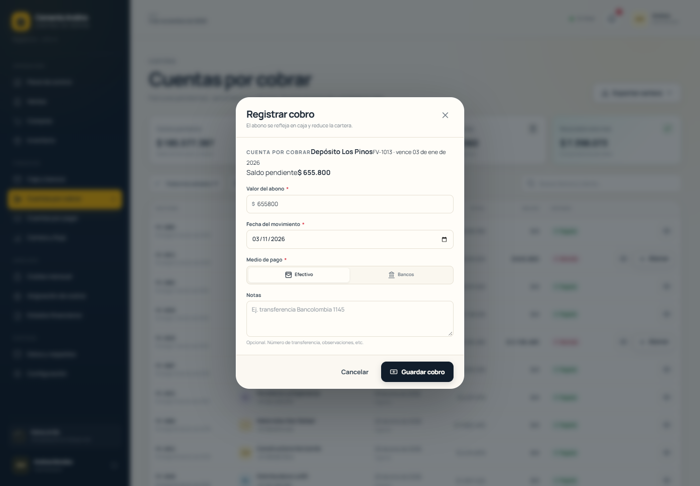
*Registro de un abono con medio de pago y 4x1000.*

El formulario de cobro muestra el saldo pendiente, la fecha, el medio y el 4x1000 estimado si el pago es por bancos. Al guardar, el abono aparece en caja y el saldo de la factura se actualiza.

> Si una factura tiene abonos, no podrás editar ni eliminar la venta original. Esto protege el historial de recaudo.

---

## 8. Cuentas por pagar

**Cuentas por pagar** reúne las obligaciones generadas por compras de producto, flete, descargue y cargue.

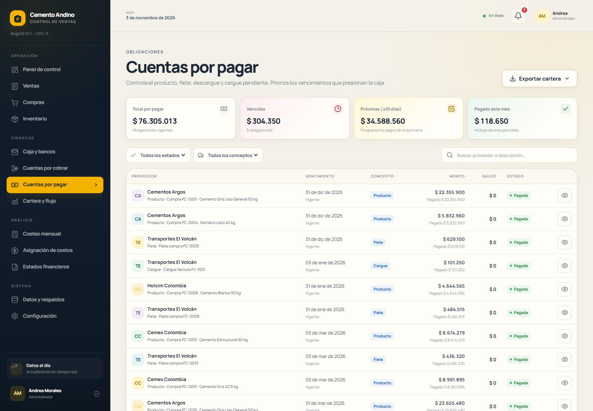
*Obligaciones por proveedor, concepto y vencimiento.*

- Filtra por estado, concepto o proveedor.
- La columna **Saldo** muestra lo que falta por pagar.
- Pulsa **Pagar** para registrar un pago total o parcial. El egreso se registra en caja o bancos.
- Pulsa el ojo para consultar el detalle y los pagos anteriores.

Las obligaciones vencidas y próximas se incluyen en las alertas del panel. Prioriza los pagos según la disponibilidad de caja.

---

## 9. Cartera y flujo de caja

**Cartera y flujo de caja** es la vista consolidada de CxC y CxP.

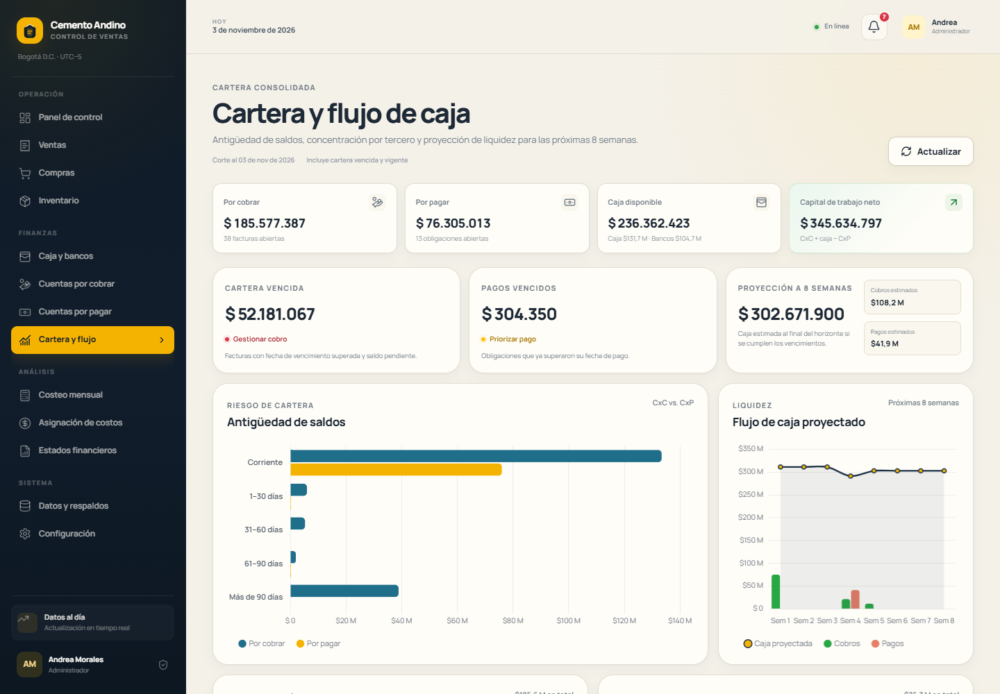
*Antigüedad de saldos, proyección de liquidez y principales terceros.*

Incluye:

- Total por cobrar, por pagar y capital de trabajo neto.
- Antigüedad de saldos por rangos: corriente, 1–30, 31–60, 61–90 y más de 90 días.
- Proyección de caja a 8 semanas, agrupando cobros y pagos por vencimiento. Los saldos vencidos se ubican en la primera semana.
- Principales deudores y acreedores.

> La proyección es un escenario base de gestión. No descuenta impuestos futuros ni movimientos no registrados.

---

## 10. Costeo mensual

**Costeo mensual** responde cuánto cuesta realmente vender cada producto y cuánto queda de utilidad después de costos indirectos.

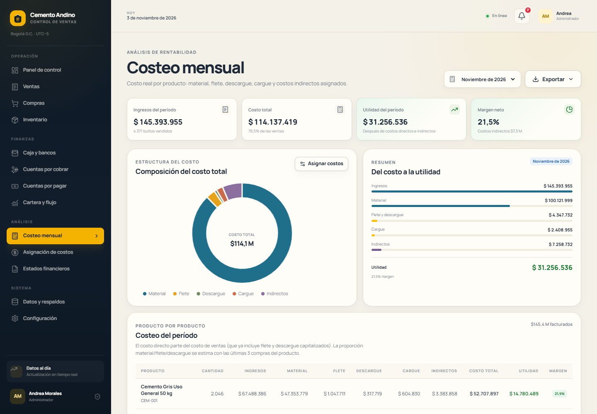
*Composición del costo, margen y detalle por producto.*

- Selecciona el mes.
- Revisa la composición del costo total.
- La tabla por producto presenta ingresos, material, flete, descargue, cargue, indirectos, costo total, utilidad y margen.
- La distribución de costos indirectos se configura en **Asignación de costos**.
- Exporta el reporte a Excel o CSV.

Los costos indirectos se pueden asignar por **volumen** (bultos vendidos) o por **valor de venta**. El 4x1000 registrado en caja se incorpora automáticamente.

---

## 11. Estados financieros

En **Estados financieros** se consultan tres reportes por mes:

- **Estado de resultados:** ingresos, costo de ventas, utilidad bruta, gastos operativos y utilidad neta.
- **Balance general:** activos, pasivos y patrimonio.
- **Flujo de caja:** saldo inicial, ingresos, egresos, flujo neto y saldo final.

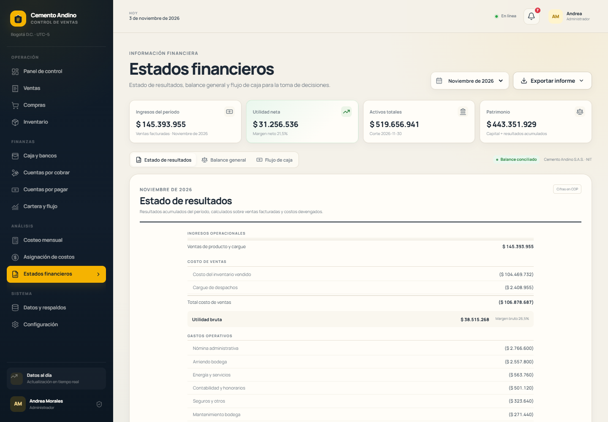
*Estado de resultados del período.*

Puedes descargar el informe completo en **PDF ejecutivo** o **Excel completo**. El PDF incluye las tres secciones.

> El balance es un reporte gerencial: incluye una línea de conciliación de resultados acumulados para que activos, pasivos y patrimonio cuadren con la operación registrada.

---

## 12. Datos y respaldos

**Datos y respaldos** permite exportar, importar y proteger la información.

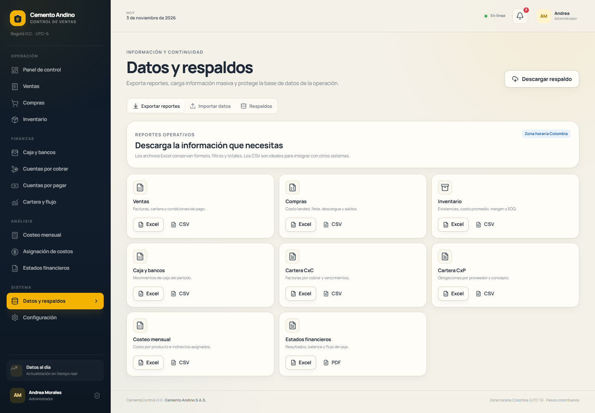
*Exportaciones por módulo y acceso a importación y respaldos.*

### Exportar

- Descarga **Excel** o **CSV** por módulo.
- **Estados financieros** también se pueden descargar en PDF.
- El botón **Descargar respaldo** (solo administrador) genera un JSON completo.

### Importar

1. Abre la pestaña **Importar datos**.
2. Descarga la plantilla del módulo.
3. Completa el archivo en Excel o CSV.
4. Carga el archivo y pulsa **Validar archivo**.
5. Revisa la previsualización y los errores.
6. Si todo está correcto, pulsa **Importar N filas**.

Importa primero clientes, proveedores y productos; después compras y ventas. La importación no escribe nada si la validación encuentra errores.

### Respaldos

- **Crear respaldo ahora:** genera un archivo JSON con toda la base.
- **Respaldo Excel:** útil para auditoría.
- **Restaurar:** reemplaza la base actual. El sistema crea automáticamente una copia pre-restauración y cierra las sesiones.
- Los respaldos automáticos se guardan una vez al día después de la hora configurada.

> Descarga un respaldo antes de cualquier restauración o actualización importante. Los respaldos contienen información sensible; protégelos.

---

## 13. Configuración

Solo el administrador puede entrar a **Configuración**.

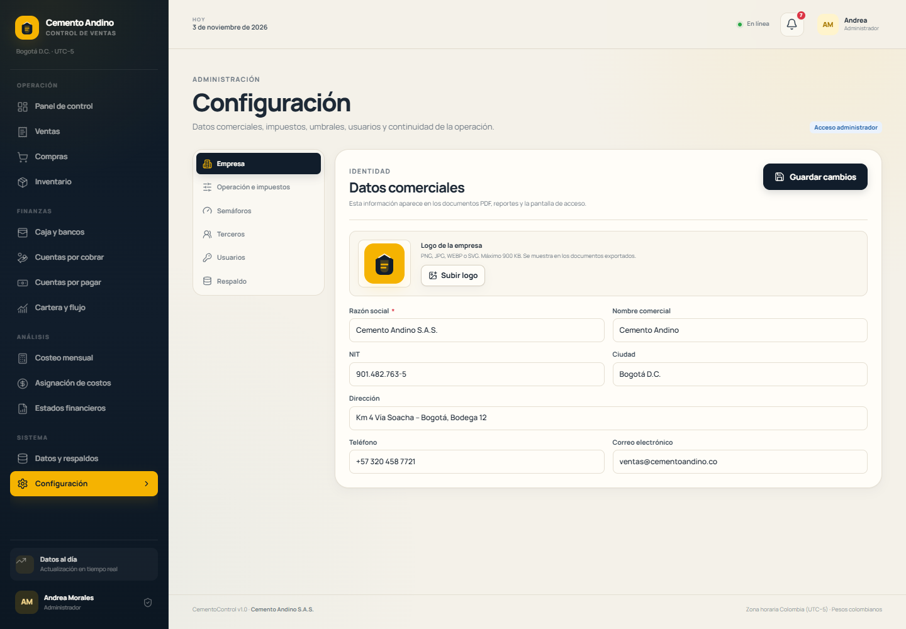
*Datos comerciales, logo y configuración de la empresa.*

### Empresa

Nombre, NIT, dirección, ciudad, teléfono, correo y logo. Esta información aparece en los documentos y reportes.

### Operación e impuestos

- Saldos iniciales de caja, bancos y capital.
- Tarifa del 4x1000 y configuración de IVA.
- Prefijos de facturas y compras.
- Parámetros por defecto de inventario.

### Semáforos

Ajusta los umbrales de crecimiento, margen, cobertura de caja, cartera vencida, rentabilidad, participación del material, concentración de clientes y cobertura de inventario. Los cambios se reflejan en el panel y en las alertas.

### Terceros

Crea, edita y elimina clientes, proveedores y coteros. Si un tercero tiene movimientos asociados, el sistema impide su eliminación.

### Usuarios

Crea usuarios con rol de administrador, vendedor o contador, restablece contraseñas y activa/desactiva cuentas. No es posible desactivar el propio usuario ni dejar la empresa sin administrador.

### Respaldo

Habilita o deshabilita el respaldo automático, define la hora y la retención. Aquí también ves el último respaldo y las copias guardadas.

> Los cambios de saldos iniciales alteran la disponibilidad de caja y el balance. Hazlos solo al iniciar la operación o durante un cierre contable.

---

## 14. Uso desde el celular

La interfaz se adapta a pantallas pequeñas. En el celular, el menú lateral se convierte en una barra inferior con los módulos principales y un botón **Más** con el resto de opciones.

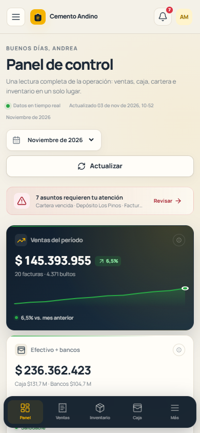
*Panel de control en un teléfono.*

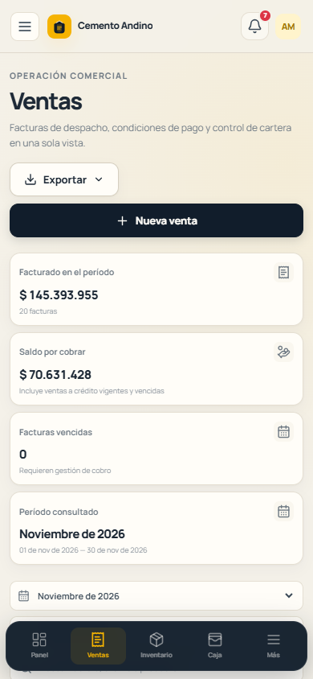
*Listado de ventas adaptado a pantalla pequeña.*

- Los formularios se muestran en pantalla completa con campos táctiles.
- Las tablas se convierten en tarjetas para mantener la legibilidad.
- Para descargar PDF o PNG desde el celular, abre el registro y pulsa el botón correspondiente.
- Si la app está en la red local, accede con la IP del PC y el puerto configurado.

---

## 15. Buenas prácticas y preguntas frecuentes

### ¿Cada cuánto debo registrar?

Registra ventas, compras y cobros el mismo día. Un dato oportuno hace que la caja y la cartera sean confiables.

### ¿Qué pasa si me equivoco?

- **Venta:** edítala si no tiene abonos; si ya tiene, registra el ajuste en cartera y consulta con el administrador.
- **Compra:** edítala mientras el inventario no se haya consumido por ventas posteriores.
- **Cobro/pago:** lo más seguro es registrar la corrección con administración; no borres movimientos automáticos.
- **Inventario:** registra un ajuste con el motivo real.

### ¿Por qué no puedo eliminar una compra?

Porque el producto ya fue vendido y el stock quedaría negativo. En ese caso edita la compra o registra una compra de ajuste y regulariza con el administrador.

### ¿Por qué el margen de un producto es diferente al de caja?

El margen usa costo promedio y valor devengado. La caja mide cuándo entra y sale el dinero. Ambas lecturas son necesarias: una mide rentabilidad, la otra liquidez.

### ¿Qué hago si la caja no coincide con el banco?

Revisa los movimientos del período en **Caja y bancos**, verifica los abonos y pagos y registra un movimiento manual conciliatorio si corresponde. La aplicación no reemplaza la conciliación bancaria formal.

### ¿Cómo cambio mi contraseña?

Abre el menú de tu perfil, arriba a la derecha, y elige **Seguridad de la cuenta**.

### ¿Dónde están mis respaldos?

En la carpeta `data/backups` de la instalación. También puedes descargarlos desde **Datos y respaldos**.

### Recomendaciones de control

1. Revisa el panel al inicio del día.
2. Cobra la cartera vencida antes de despachar nuevas facturas a crédito.
3. No permitas ventas a clientes morosos sin autorización.
4. Registra el cargue y el descargue: forman parte del costo real.
5. Compara mensualmente el costo de compra con el precio de venta.
6. Cierra el mes revisando caja, inventario y cartera antes de generar los estados financieros.
7. Descarga un respaldo al final de cada semana.

---

**Soporte:** consulta los documentos técnicos del proyecto o contacta al administrador del sistema.  
CementoControl · Hecho para operaciones de cemento con datos claros y decisiones a tiempo.
